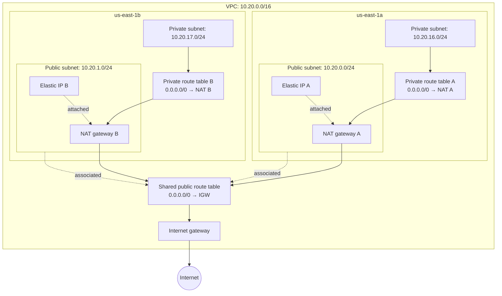

# Network layout and address plan

This diagram describes the Terraform configuration, not a live AWS deployment.
The VPC spans us-east-1a and us-east-1b. Solid arrows show internet egress; dotted lines show associations.

All route tables also have AWS's implicit local route for VPC traffic. The diagram focuses on default internet routes.
Four route-table associations bind each subnet to its correct table.
Public/private classification comes from routes; map_public_ip_on_launch=false does not make the public subnets private.
No application workloads, ALBs or ECS resources are deployed by this module.

## Why 10.20.0.0/16?
It is an example from the RFC 1918 private 10.0.0.0/8 address range.
The number 20 is an organizational choice, not an AWS requirement or a proven conflict-free allocation.
A /16 contains 65,536 addresses and can be divided into 256 /24 subnet ranges.
A smaller VPC could serve this tutorial; /16 leaves room to grow and keeps subnet math easy.
Unused private address space itself does not incur AWS charges, but allocating it reduces space available in your wider IP plan.

| AZ | Public subnet | Private subnet |
| --- | --- | --- |
| us-east-1a | 10.20.0.0/24 | 10.20.16.0/24 |
| us-east-1b | 10.20.1.0/24 | 10.20.17.0/24 |

Each /24 has 256 addresses; AWS reserves five, leaving 251 assignable addresses.
These are not all necessarily available for future tasks: other ENIs and services also use addresses.
cidrsubnet(vpc_cidr, 8, index) extends /16 to /24.
Public subnets use indexes 0 and 1. Private subnets use 16 and 17 for visual separation and future allocation space; AWS does not require that gap.
Keep the AZ list ordering stable because indexes determine subnet CIDRs.

Before the first apply, compare this CIDR with existing VPC, VPN and on-premises networks you intend to connect. No overlap check against your AWS account has been performed.
The module currently enforces a /16 input; changing its size requires adjusting the subnet calculation and validation together.

## One NAT gateway per AZ
Each public subnet contains a zonal NAT gateway with a dedicated Elastic IP.
Private subnet A routes internet traffic through NAT A; private subnet B routes through NAT B.
Internet egress does not cross AZs to reach a NAT gateway. An AZ failure no longer removes the other AZ's NAT path.
Both NAT gateways use their public subnet's shared route table and the VPC internet gateway.
Two NAT gateways and two Elastic IPs incur charges until removed.
NAT permits outbound connections and their responses; it does not expose a private service to unsolicited internet connections.
Terraform output nat_gateway_ids maps AZ names to gateway IDs.

## Dynamic account identity
The old aws_account_id input was used only as an allowed_account_ids guard on the AWS provider.
It prevented a credential/account mismatch; it did not select or log into an account.
This network module now uses the AWS provider's active credentials and reads its effective identity using aws_caller_identity.current.
Outputs aws_account_id and aws_caller_arn make the effective account and role visible.
No account ID input is required. A wrong active session is no longer rejected by a fixed-account allowlist.
Do not put a caller-identity data reference into the provider's allowed_account_ids: the data source depends on that provider.
Check aws sts get-caller-identity with the same credentials before applying.
With an assumed role, caller identity reflects the effective role/account, not necessarily the original login.
The S3 backend is initialized separately; its bucket name and state key remain literal settings in versions.tf.

References:
- https://docs.aws.amazon.com/vpc/latest/userguide/vpc-cidr-blocks.html
- https://docs.aws.amazon.com/vpc/latest/userguide/subnet-sizing.html
- https://docs.aws.amazon.com/vpc/latest/userguide/nat-gateway-basics.html
- https://registry.terraform.io/providers/hashicorp/aws/latest/docs/data-sources/caller_identity
